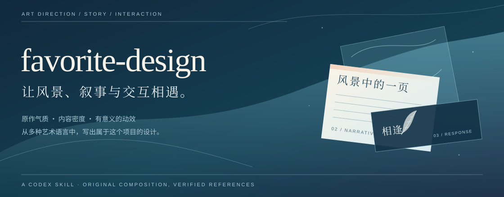
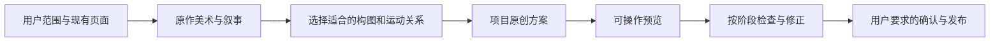

<p align="center">
  
</p>

<h1 align="center">favorite-design</h1>

<p align="center">
  面向 Codex 的视觉小说网站艺术指导技能<br>
  <sub>Art direction for illustrated, story-driven websites.</sub>
</p>

<p align="center">
  <a href="#30-秒了解">用途</a> ·
  <a href="#安装到-codex">安装</a> ·
  <a href="#如何使用">使用</a> ·
  <a href="#设计从哪里来">设计来源</a> ·
  <a href="#如何验收">验收</a> ·
  <a href="#项目记录">案例</a> ·
  <a href="#素材与许可证">许可</a>
</p>

## 30 秒了解

`favorite-design` 帮助 Codex 从原作美术、真实叙事和已观察的网页交互出发，设计一个可以进入、停留和阅读的世界。它吸收 FAVORITE 不同作品及官方移植站的构图语言，也给新项目留下独立的创作空间。

| 你要解决的问题 | 技能提供的判断 |
| --- | --- |
| 页面很空，原图被小卡片包住 | 用场景、立绘、正文和线索组织空间，恢复有意义的密度 |
| 窄范围修复演变成整站重做 | 先读原版和已批准的范围，明确哪些位置真的要改变 |
| 原版有氛围，预览版有秩序 | 保留作品气质，再统一文字层级、导航和共享UI几何 |
| 动效很多却没有叙事关系 | 分别安排入场、人物出现、章节转场和环境运动 |
| 素材很多，却不能说明来源 | 区分原作、转述和本站原创，记录图像与语音的出处 |

**适合**：个人作品站、视觉小说主题博客、人物和世界档案，以及现有插画网站的局部修复。使用者提供素材、项目与授权范围；技能根据内容决定构图。

## 安装到 Codex

仓库为 [NikaidouShinku0721/favorite-design](https://github.com/NikaidouShinku0721/favorite-design)，技能位于 `favorite-design/SKILL.md`。安装目标为 `favorite-design` 目录。

### 让 Codex 安装

在 Codex 中发送：

```text
$skill-installer
从 https://github.com/NikaidouShinku0721/favorite-design 安装 favorite-design 目录中的技能。
```

### 使用内置安装脚本

需要 Python 3 和 Codex 的内置 `skill-installer`。该脚本从指定 GitHub 目录安装，默认目标为 `$CODEX_HOME/skills`；未设置时使用 `~/.codex/skills`。这是一个普通技能目录，不要求额外的插件市场。

<details>
<summary><strong>Windows · PowerShell</strong></summary>

```powershell
$skillRepository = 'NikaidouShinku0721/favorite-design'
$codexRoot = if ($env:CODEX_HOME) {
  $env:CODEX_HOME
} else {
  Join-Path $env:USERPROFILE '.codex'
}

python (Join-Path $codexRoot 'skills\.system\skill-installer\scripts\install-skill-from-github.py') `
  --repo $skillRepository `
  --path favorite-design
```

默认安装结果：`C:\Users\你的用户名\.codex\skills\favorite-design\SKILL.md`。

</details>

<details>
<summary><strong>Linux / macOS · shell</strong></summary>

```bash
codex_root="${CODEX_HOME:-$HOME/.codex}"

python3 "$codex_root/skills/.system/skill-installer/scripts/install-skill-from-github.py" \
  --repo NikaidouShinku0721/favorite-design \
  --path favorite-design
```

默认安装结果：`~/.codex/skills/favorite-design/SKILL.md`。

</details>

已存在同名目标目录时，内置安装脚本会停止。更新前先保存自己的修改；可以用 `--ref` 固定已发布标签。安装完成后，在下一轮对话调用 `$favorite-design`。

## 如何使用

给出项目位置、参考来源和真正需要修改的范围。参考可以是官网、视频或当前页面，但它们分别证明静态构图、动作节奏和项目现状；不要把三者混为一份模板。

### 修复一个入口

```text
$favorite-design
调整首页两枚入口：使用清楚的泛光文字，完整羽毛在文字下面一层，
悬停与键盘焦点时出现。保留首屏背景和原作光标。
先提供可操作预览，并检查共享点击框是否发生位移。
```

### 折中原版与预览

```text
$favorite-design
结合原版的场景、全身立绘和正文密度，与预览版的阅读层级及连续导航，
提出新的构图。解释选择哪些设计原则，以及哪些部分是本项目的原创设计。
按开篇、绘本、人物、全站交互分阶段检查。
```

### 为新作品定调

```text
$favorite-design
为这部作品设计网站。先从它的叙事与现有美术确定气质，
再选择适合的排版和运动关系；列出素材出处与需要保留的区域。
为人物相逢设计有剧情根据的交互，让环境运动在阅读时保持安静。
```

以上是使用提示，不能当作已实测演示。实际三部曲项目暴露并修正了完整羽毛层次、全身立绘、慢图身份提交、初始锚点和上下文语音等问题；方法与证据边界见 [项目经验](favorite-design/references/project-lessons.md)。实际部署与检查范围见下方 [项目记录](#项目记录)。

## 设计从哪里来

FAVORITE 的作品并不只有一种蓝天羽毛语言。夜樱、星空、雪光、舞台与暖色纸面，可以导向很不一样的设计。`favorite-design` 提取这些语言中的关系：原画如何承载身份、正文如何落在画面中、人物与场景如何共同出现、读者如何沿章节前进。

| 气质 | 参考站 | 可迁移的关系 |
| --- | --- | --- |
| 海风与记忆 | [いろとりどりのセカイ HD](https://www.favo-soft.jp/soft/product/WorldsEndHD/index.html) | 外部世界连续，人物的近景随相逢改变 |
| 夜樱与叙事 | [さくら、もゆ。PC](https://www.favo-soft.jp/soft/product/sakura/index.html) · [ENTERGRAM移植站](https://www.entergram.co.jp/sakuramoyu/) | 场景、纵句、标志和入口形成不同的揭幕时刻 |
| 星光与档案 | [星空のメモリア HD](https://www.favo-soft.jp/soft/product/hoshimemo_hd/index.html) | 大原画之后仍保留紧凑、丰富的阅读内容 |
| 雪与光 | [アストラエア FHD](https://www.favo-soft.jp/soft/product/astralair_fhd/index.html) | 冷色环境与温暖人物、局部纸面的互补 |
| 演出与庆典 | [ハッピーライヴ](https://www.favo-soft.jp/soft/product/happylive_showup/index.html) | 丰富群像和鲜明章节支撑更活跃的叙事 |
| 轻盈的章节导航 | [WORLD’S END -RE:BIRTH-](https://dramaticcreate.com/world_re/world.html) | 固定操作槽、衬线文字、图形与字形的叠层 |

研究从 [FAVORITE官方作品目录](https://www.favo-soft.jp/soft/product.html) 建立覆盖范围。已读取目录当时列出的24个入口，并对上述三处重点站点保留动作证据；这不等同于研究了所有历史活动、子页面或旧Flash动画。参见 [八类设计语言](favorite-design/references/favorite-family-study.md)、[记录中的动态关系](favorite-design/references/recording-evidence.md) 和 [来源与证据边界](favorite-design/references/source-evidence.md)。原站完整截图、录屏和下载的源码不随技能分发。

## 怎样形成新设计



| 层次 | 设计任务 | 要保留的约束 |
| --- | --- | --- |
| 环境 | 决定场景、明暗、文字落点和章节联系 | 地点线索及关键原画区域可辨认 |
| 人物 | 让立绘、近景、资料和台词成为同一次相逢 | 身份、来源正确；切换不会推挤公共UI |
| 装饰 | 将完整图形放在有作用的层次 | 羽毛与文字的上下关系正确，不截断或截获点击 |
| 功能 | 让导航、阅读与触发机制清楚 | 尺寸一致，键盘和触屏均可用 |

每个项目都应发展自己的章节形态、文字组织和动态节奏。五秒自动轮换、羽毛飘落、全屏开场或隐式语音都是具体项目的选择，不能自动变成所有网站的规定。

## 如何验收

验收依据是画面、操作和来源证据。视觉评价要指出具体构图问题，不能用未经定义的“AI含量百分比”代替观察。

| 项目 | 具体检查 |
| --- | --- |
| 首屏 | 场景覆盖预期视窗；顶部没有空白拼接；人物脸部与重要标志未被遮断 |
| 完整装饰 | 桌面、平板、手机各看一次章段接缝；图形不被短容器切碎，文字处于正确层次 |
| UI一致性 | 记录共有导航与操作槽的 `x/y/width/height`；切换主题、人物、悬停和焦点前后无意外变化 |
| 人物舞台 | 全身立绘确实包含脚部；快速切换结束在最后一次选择，场景、名字与资料一致 |
| 动态关系 | 录屏逐段对比入场和人物出现；阅读层保持稳定，减少动态设置保留完整信息 |
| 语音 | 逐人物检查说话人、台词和场景；自动触发不过密、不重叠，离开场景和开场影片时正确停止 |
| 失败处理 | 图像或音频失败后仍有可读内容；没有空白页或失效的导航 |
| 范围与交付 | 如实区分研究、预览、正式实现和公开部署；先完成用户要求的确认再发布 |

这些是实施时的验收方法，按本次改动涉及的功能使用。本包没有声称全部已在跨项目环境中验证。

## 项目记录

本技能来自一次真实的三部曲主题个人博客改进。预览获批后，网站完成正式合并并于 **2026-10-12** 发布：

- [访问风津之滨·世界绘本](https://nikaidoushinku0721.github.io/)
- [网站发布提交 `e1851af`](https://github.com/NikaidouShinku0721/NikaidouShinku0721.github.io/commit/e1851afd4e8d8d1d00f2850e88da4793637037a0)

GitHub Pages #59 部署成功。下面分别列出本地交互结果与线上交付范围，不将两者合并成“所有线上交互均已验证”。

| 问题 | 修正与已观察结果 |
| --- | --- |
| 共有导航存在细微位移 | 修正继承字距后，1440 CSS px 下首页与 archives 的共同槽矩形差为 0；短博客另暴露有/无滚动条的 6 px 差异；保留共同槽后，375/768/1440 CSS px 的首页与短博客共有框矩形差均为 0，375 无横向溢出 |
| 博客标题在简化时丢失，侧栏目录重复 | 移动节点前将 live collection 转为数组；精确替换既有直接子导航；语义与静态输出回归保留正文、代码、搜索、目录、文章入口和评论 |
| 合并留言页可能丢失旧讨论 | 沿用原 Waline `/message/` 身份，读到 12 条既有评论；Markdown 编辑与预览通过，未提交测试评论 |
| 博客与旧入口需要保留 | 博客搜索恢复；about、message、links、world archive 对象及 picturebook 的旧入口在本地浏览器到达对应章节 |
| 点击人物的声音覆盖不足 | 九个人物进入及九个立绘点击均观察到播放；验证具体说话人/上下文，不将播放开始写成全部听辨完成 |
| 手机开场与退出 | 375 CSS px 的开场影片实际加载并播放；Skip 清空 source、暂停媒体、解除滚动锁并恢复触发器焦点 |

线上独立 HTTP 检查 **62/62 通过**：59 个完整资源（页面、CSS/JS、JSON、Waline vendor、19 段原声及关键图）HTTP 200 且与本地生成文件 SHA-256 一致；三个开场视频 Range 请求 HTTP 206，范围和首 1024 字节一致，未下载完整视频。线上浏览器的实际可访问性树已确认新标题和所有章节。

此线上检查覆盖部署产物与首页内容，不能代替全部动效、每个人物语音、完整视频或评论服务的线上交互复测。线上自动化接口延迟影响了追加操作；本地完整交互记录与线上结果分别报告。[项目经验](favorite-design/references/project-lessons.md)保留设计修正与证据边界。项目原图、语音和私有 QA 数据不放进本技能包。

## 仓库结构

```text
favorite-design/
├── README.md
├── LICENSE
├── assets/
│   └── cover.svg                    # 本仓库原创概念图
└── favorite-design/
    ├── SKILL.md                      # 范围、构图、交互与交付规则
    ├── agents/
    │   └── openai.yaml               # Codex显示名称与默认提示
    └── references/
        ├── favorite-family-study.md # 多种设计语言与创新方法
        ├── recording-evidence.md    # 动作证据与可推断的边界
        ├── source-evidence.md       # 官方链接、来源与分发边界
        └── project-lessons.md       # 异步提交与锚点等真实问题
```

项目本地的录屏、网页原图、游戏解包文件和原始语音不随技能分发。需要新增参考时，应先写清来源、观察对象及结论，再决定哪些说明适合公开。

## 素材与许可证

[MIT 许可](LICENSE)覆盖本仓库自行编写的指令、说明文档及原创矢量概念图。FAVORITE及移植站的名称、作品、人物、美术、语音和网站素材属于各自权利方，本技能不转授它们的使用许可，也不与这些公司构成官方关联。

原始官网数据不能因“非商业学习”就任意再分发。具体作品的素材使用应查看 [FAVORITE官方指南](https://www.favo-soft.jp/soft/guideline.html) 与相应站点声明；本仓库以来源链接和原创说明呈现研究结论。

## 贡献

欢迎提供能够改变设计判断的证据：原站链接、观察到的交互、构图问题及修正后的比较。提交改进时说明任务范围、执行环境和检查结果；不要提交解包素材包、原始语音或无法说明来源的参考图。

发布页的信息结构参考 [obra/superpowers](https://github.com/obra/superpowers) 的用途、安装与工作方式导航，以及 [anthropics/skills](https://github.com/anthropics/skills) 对技能目录与许可范围的说明。这里采用自己的文字、图形与项目范围。

---

### English

**favorite-design** is a Codex skill for illustrated, story-driven websites. It studies several visual languages across FAVORITE works and their official port sites, then helps choose a composition, reading rhythm and meaningful interaction for a particular project.

Use `$favorite-design` with your project, references and requested scope. The skill supports both small UI repairs and broader art direction. Reference observations, source-code findings and new design ideas are kept distinct. Original game art and audio are not included in the distributable skill.

The companion website has been deployed; local interaction checks, online resource integrity and the observed online page content are documented separately. This does not claim that every interaction has been repeated online. Install `favorite-design` from this repository with Codex's built-in skill installer. The default destination is `$CODEX_HOME/skills`, or `~/.codex/skills`. The MIT license covers only this repository's original work.
